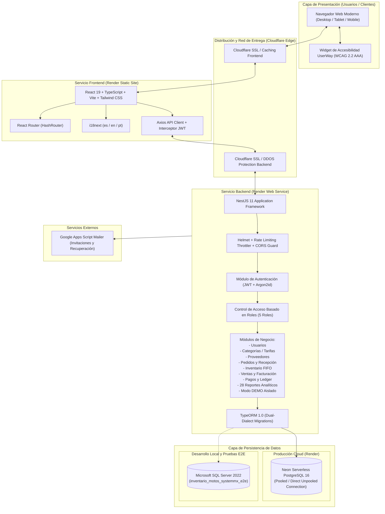
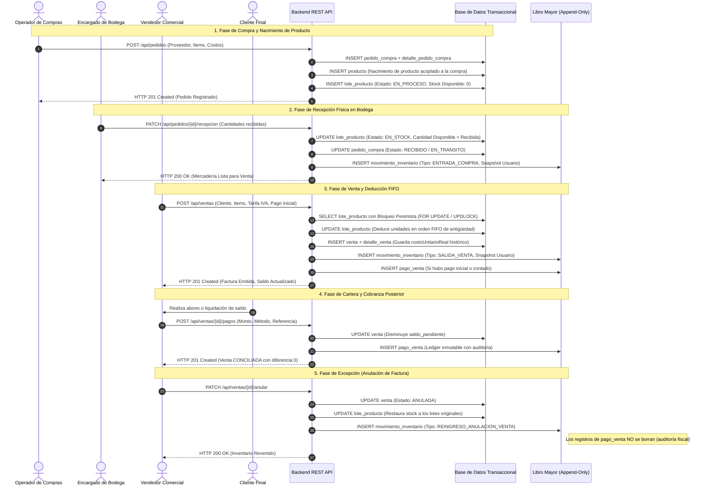
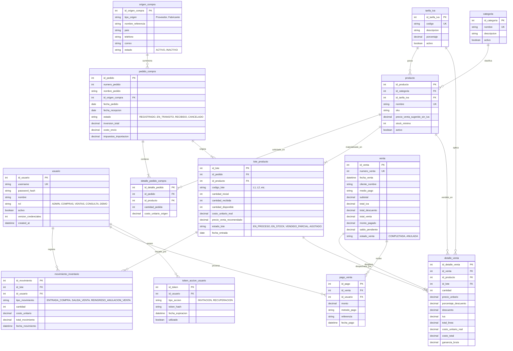

# 01 — ARQUITECTURA Y TECNOLOGÍAS — SYSTEM MX

**Proyecto:** System MX — Plataforma Web de Gestión Comercial y Control de Inventarios  
**Versión:** 1.0.0 (Estabilización Final de Entrega)  
**Fecha:** Noviembre de 2026  
**Autores:** Equipo de Desarrollo System MX  

---

## 1. RESUMEN EJECUTIVO Y PROPÓSITO DEL SISTEMA

**System MX** es una solución integral de software empresarial diseñada para optimizar, centralizar y auditar el ciclo comercial completo de una organización comercializadora (especializada en repuestos, accesorios y motocicletas). La plataforma abarca desde el aprovisionamiento con proveedores internacionales y locales, control de pedidos de compra, recepción física en almacén mediante lotes de inventario bajo metodología **FIFO (First In, First Out)**, facturación de ventas con tarifas impositivas dinámicas (IVA), seguimiento de cuentas por cobrar, conciliación de pagos en un libro mayor (*ledger*) inmutable (*append-only*), hasta la generación de 28 reportes gerenciales reconciliados y auditoría forense de usuarios.

---

## 2. DIAGRAMA GENERAL DE ARQUITECTURA

La arquitectura del sistema responde a un modelo desacoplado de micro-servicios lógicos basado en **Frontend SPA (Single Page Application)** y **Backend REST API**, desplegados en la nube sobre la infraestructura de **Render** y persistencia en **Neon Serverless PostgreSQL**, manteniendo soporte dual local con **Microsoft SQL Server**.

---

## 3. COMPONENTES DEL FRONTEND

El frontend de System MX ha sido desarrollado con tecnologías modernas orientadas a rendimiento, accesibilidad universal y seguridad:

| Tecnología | Versión | Rol Arquitectónico |
|---|---|---|
| **React** | 19.2.0 | Biblioteca central de renderizado declarativo e interfaz reactiva |
| **TypeScript** | 5.9.3 | Tipado estático estricto en todos los componentes, DTOs y utilidades |
| **Vite** | 7.3.1 | Empaquetador ultrarrápido y servidor de desarrollo HMR |
| **Tailwind CSS** | 4.1.18 | Motor de estilos utilitarios responsive y temas cromáticos con contraste accesible |
| **React Router** | 7.9.4 | Enrutamiento del lado del cliente configurado con `HashRouter` para compatibilidad estática CDN |
| **i18next / react-i18next** | 25.6.0 | Motor de internacionalización con paridad 100% de llaves en Español, Inglés y Portugués |
| **UserWay Widget** | v4 | Integración oficial de accesibilidad para lectura de pantalla, contraste y tamaño textual |
| **Lucide React** | 1.16.0 | Biblioteca de iconografía vectorial semántica |
| **Vitest** | 5.0.0 | Entorno de pruebas unitarias y de integración rápida en Node/JSDOM |
| **axe-core** | 4.11.1 | Motor de auditoría automatizada de accesibilidad (WCAG 2.2 AAA) |

### Estructura Modular del Frontend:
- `src/api/`: Configuración centralizada de Axios con interceptor automático para inyección de token Bearer y manejo de renovación/expiración.
- `src/auth/`: Proveedor de contexto `AuthProvider`, rutas protegidas `ProtectedRoute` y páginas de autenticación (`LoginPage`, `RegistroPage`, `ActivarCuentaPage`, `RecuperarPasswordPage`, `RestablecerPasswordPage`).
- `src/components/`:
  - `common/`: Componentes atómicos reusables y accesibles (`InputField`, `SelectField`, `MoneyInputField`, `DataTableShell`, `AppModal`, `ConfirmDialog`, `PasswordStrengthIndicator`, `LanguageSelector`).
  - `usuarios/`: Administración y gestión de estados de usuarios para rol `ADMIN`.
  - `proveedores/`, `categorias/`, `tarifas-iva/`: Mantenimiento de catálogos base.
  - `pedidos/`: Creación de órdenes de compra y asistente de recepción física de mercadería.
  - `inventario/`, `lotes/`, `movimientos/`: Visualización en tiempo real de lotes y kardex de movimientos.
  - `ventas/`: Punto de venta con cálculo impositivo dinámico y selección FIFO.
  - `cuentas-por-cobrar/`: Seguimiento de cartera y registro de abonos.
  - `reportes/`: Centro analítico con 28 reportes organizados en 7 familias y exportación CSV/PDF.
  - `demo/`: Panel interactivo para rol `DEMO` con métricas y catálogos de muestra aislados.
- `src/i18n/`: Archivos JSON de localización (`es.json`, `en.json`, `pt.json`) y detector de idioma del navegador.

---

## 4. COMPONENTES DEL BACKEND

El backend se estructura mediante **NestJS**, respetando el principio de responsabilidad única, inyección de dependencias y arquitectura modular empresarial:

| Tecnología | Versión | Rol Arquitectónico |
|---|---|---|
| **NestJS (`@nestjs/core`)** | 11.1.27 | Framework empresarial modular basado en Express |
| **TypeScript** | 5.7.3 | Tipado completo de controladores, servicios, repositorios y entidades |
| **TypeORM** | 1.0.0 | Mapeador relacional de objetos con control estricto de migraciones |
| **PostgreSQL Driver (`pg`)** | 8.13.3 | Conector para la base de datos de producción en Neon |
| **Microsoft SQL Driver (`mssql`)**| 12.6.0 | Conector para entorno de desarrollo local y suite de pruebas E2E |
| **Argon2 (`argon2`)** | 0.45.1 | Algoritmo de hashing de contraseñas de vanguardia (Argon2id) |
| **NestJS JWT (`@nestjs/jwt`)** | 11.0.2 | Generación y validación criptográfica de tokens JWT HMAC-SHA256 |
| **Throttler (`@nestjs/throttler`)**| 6.5.0 | Limitador de peticiones por ventana de tiempo contra ataques de fuerza bruta |
| **Helmet** | 8.3.0 | Configuración de cabeceras HTTP de endurecimiento (CSP, X-Frame-Options, HSTS) |
| **Class-Validator & Class-Transformer**| 0.14.1 | Validación declarativa de DTOs con rechazo de atributos no permitidos (`whitelist: true`, `forbidNonWhitelisted: true`) |
| **Jest & Supertest** | 30.0.0 / 7.0.0 | Framework de pruebas unitarias, integración de servicios y pruebas E2E |

### Módulos del Backend:
1. **AuthModule**: Gestión de tokens, verificación de credenciales, activación de cuentas, restablecimiento de contraseñas y registro evaluativo.
2. **UsuariosModule**: CRUD de usuarios, gestión de invitaciones por correo electrónico y validación de políticas de contraseña.
3. **ProveedoresModule** y **CategoriasModule**: Control de proveedores y familias de artículos.
4. **TarifasModule**: Mantenimiento de impuestos de valor agregado (IVA) configurables.
5. **PedidosModule**: Órdenes de compra internacionales/nacionales y lógica transaccional de recepción en almacén con creación de lotes.
6. **InventarioModule**: Consulta de disponibilidad, desglose por lote y trazabilidad del libro de movimientos.
7. **VentasModule**: Registro de transacciones de venta, bloqueo pesimista contra condiciones de carrera, deducción FIFO, cálculo de ganancia real y reversión por anulación.
8. **ReportesModule**: Motor de reportería analítica compuesto por 6 sub-servicios especializados (Ventas, Compras, Inventario, Pagos, Auditoría y Resumen).
9. **DemoModule**: Endpoints con datos ficticios para evaluación controlada sin acceso a datos reales.
10. **MailModule**: Integración asíncrona mediante webhooks seguros con Google Apps Script para despacho de notificaciones transaccionales.

---

## 5. FLUJO DE DATOS Y CICLO COMERCIAL COMPLETO

El ciclo comercial de System MX garantiza la consistencia transaccional y la trazabilidad financiera desde la compra inicial hasta el cobro final:

---

## 6. DECISIONES TÉCNICAS JUSTIFICADAS

1. **Arquitectura Dual-Dialect de Base de Datos:**
   - *Decisión:* Permitir que el sistema ejecute de manera transparente sobre **PostgreSQL** (para producción cloud gratuita y escalable en Neon) y sobre **Microsoft SQL Server** (para entornos corporativos locales, desarrollo y pruebas E2E aisladas).
   - *Justificación:* Asegura máxima portabilidad sin atar el proyecto a un único proveedor de base de datos. Las migraciones detectan automáticamente el dialecto de la conexión y aplican la sintaxis adecuada (`IDENTITY(1,1)` vs `SERIAL`, `datetime2` vs `timestamptz`, `bit` vs `boolean`).

2. **`synchronize: false` Permanente (Migration-First):**
   - *Decisión:* Desactivar completamente la sincronización automática de TypeORM en todos los ambientes.
   - *Justificación:* Evita modificaciones destructivas en caliente, alteración inadvertida de tipos de datos o eliminación de columnas en producción. Toda alteración estructural requiere una migración versionada y auditada.

3. **Ledger Inmutable (*Append-Only*) para Inventario y Pagos:**
   - *Decisión:* Las tablas `movimiento_inventario` y `pago_venta` no cuentan con operaciones `UPDATE` ni `DELETE` en la API.
   - *Justificación:* Garantiza la integridad contable y la trazabilidad forense. Toda corrección de inventario se realiza mediante un nuevo movimiento en sentido opuesto (`REINGRESO_ANULACION_VENTA`), preservando el historial para auditorías externas.

4. **Nacimiento de Productos Acoplado al Pedido de Compra:**
   - *Decisión:* No permitir crear productos huérfanos sin una orden de compra o proveedor asociado.
   - *Justificación:* Elimina discrepancias en el catálogo de artículos y asegura que todo artículo tenga siempre registrado su costo unitario de origen, tasa cambiaria y lote de procedencia.

5. **HashRouter en Frontend:**
   - *Decisión:* Implementar `HashRouter` en React Router en lugar de `BrowserRouter`.
   - *Justificación:* Garantiza el correcto funcionamiento de las rutas en servidores estáticos (CDN de Render, GitHub Pages o S3) sin requerir reescrituras complejas del servidor web Nginx/Apache al recargar páginas profundas (`F5`).

6. **Algoritmo Argon2id para Contraseñas:**
   - *Decisión:* Reemplazar algoritmos heredados (MD5, SHA-256 o bcrypt simple) por **Argon2id**.
   - *Justificación:* Es el estándar recomendado por OWASP y ganador de la Password Hashing Competition, resistente a ataques acelerados por GPU y circuitos ASIC gracias a su consumo configurable de memoria y tiempo.

---

## 7. MODELO DE DATOS ENTIDAD-RELACIÓN

El sistema opera sobre **13 tablas relacionales** rigurosamente normalizadas (en 3FN) con integridad referencial garantizada por llaves foráneas (`FOREIGN KEY`) y restricciones de unicidad (`UNIQUE`):

---

## 8. CONCLUSIONES DE ARQUITECTURA

La arquitectura de **System MX** garantiza alta cohesión, bajo acoplamiento y cumplimiento riguroso de principios de seguridad e integridad financiera. Su diseño dual-dialect y su separación estricta entre la capa de presentación (SPA con accesibilidad WCAG 2.2 AAA e internacionalización) y la capa de servicios (NestJS con RBAC y ledger append-only) proporcionan una base sólida, mantenible y preparada para entornos de producción corporativos.
