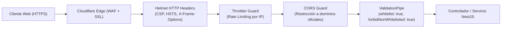

# 03 — MANUAL TÉCNICO Y DE SEGURIDAD — SYSTEM MX

**Proyecto:** System MX — Plataforma Web de Gestión Comercial  
**Versión:** 1.0.0 (Estabilización Final)  
**Fecha:** Noviembre de 2026  
**Clasificación de Seguridad:** Confidencial / Auditoría de Seguridad  

---

## 1. MODELO DE CONTROL DE ACCESO BASADO EN ROLES (RBAC)

El sistema implementa un control de acceso granular basado en 5 roles formales (`RolUsuario`), verificado tanto a nivel de controladores y servicios backend mediante los decoradores `@Roles(...)` y el guardián `RolesGuard`, como a nivel de interfaz de usuario mediante `ProtectedRoute` y el hook `usePermissions`.

### 1.1 Definición de los 5 Roles del Sistema

1. **`ADMIN` (Administrador General):**
   - Acceso irrestricto a todos los módulos operativos y de configuración.
   - Capacidad exclusiva de invitar, activar, suspender o cambiar el rol de usuarios.
   - Acceso exclusivo a los reportes de auditoría forense (`/api/reportes/auditoria/*`).
   - Mantenimiento de tarifas impositivas (IVA) y parámetros del sistema.

2. **`COMPRAS` (Gestor de Aprovisionamiento):**
   - Creación y edición de órdenes de compra a proveedores (`/api/pedidos`).
   - Recepción física de mercadería en almacén (parcial y total) con actualización de lotes a `EN_STOCK`.
   - Consulta y registro de proveedores (`/api/proveedores`) y categorías (`/api/categorias`).
   - Consulta de stock disponible y reporte de compras por proveedor y período.
   - *Restricción:* No tiene acceso a facturar ventas, registrar cobros de clientes ni consultar auditoría de usuarios.

3. **`VENTAS` (Ejecutivo Comercial y Cobranzas):**
   - Emisión de facturas y ventas comerciales (`/api/ventas`) con deducción automática FIFO.
   - Consulta de inventario disponible y catálogos de productos.
   - Registro de abonos y cancelación de saldos en cuentas por cobrar (`/api/ventas/:id/pagos`).
   - Anulación de ventas comerciales con reversión de inventario.
   - Consulta del reporte de cuentas por cobrar (`/api/reportes/cuentas-por-cobrar`).
   - *Restricción:* No tiene acceso a crear pedidos de compra, recibir mercadería, modificar tarifas de IVA ni consultar reportes gerenciales globales o de auditoría.

4. **`CONSULTA` (Auditor de Negocio / Gerencia):**
   - Acceso de solo lectura (`GET`) a los catálogos y a los 26 reportes analíticos de negocio (Ventas, Compras, Inventario, Pagos, Conciliación Financiera y Cuentas por Cobrar).
   - *Restricción:* Prohibición total de mutación (`POST`, `PATCH`, `DELETE`). No puede crear ventas, registrar compras, alterar inventario ni acceder a la auditoría interna de usuarios.

5. **`DEMO` (Modo Demostración Evaluativa):**
   - Rol asignado por defecto al registro público de usuarios evaluadores.
   - Acceso restringido exclusivamente a `/api/demo/resumen`.
   - Aislamiento total: no puede visualizar ni alterar datos comerciales reales (proveedores, inventario, ventas, compras ni usuarios reales).
   - Recibe datos simulados en memoria y mensajes educativos que orientan sobre la necesidad de solicitar la elevación de privilegios al administrador.

---

### 1.2 Matriz Detallada de Permisos por Módulo y Endpoint

| Módulo / Funcionalidad | Endpoint REST | Método | ADMIN | COMPRAS | VENTAS | CONSULTA | DEMO |
|---|---|:---:|:---:|:---:|:---:|:---:|:---:|
| **Autenticación (Login, Me)** | `/api/auth/login`, `/me` | POST, GET | ✅ | ✅ | ✅ | ✅ | ✅ |
| **Gestión de Usuarios** | `/api/usuarios/**` | Todos | ✅ | ❌ (403) | ❌ (403) | ❌ (403) | ❌ (403) |
| **Categorías (Lectura)** | `/api/categorias` | GET | ✅ | ✅ | ✅ | ✅ | ❌ (403) |
| **Categorías (Mutación)** | `/api/categorias` | POST, PATCH | ✅ | ✅ | ❌ (403) | ❌ (403) | ❌ (403) |
| **Tarifas IVA (Lectura)** | `/api/tarifas-iva` | GET | ✅ | ✅ | ✅ | ✅ | ❌ (403) |
| **Tarifas IVA (Mutación)** | `/api/tarifas-iva` | POST, PATCH | ✅ | ❌ (403) | ❌ (403) | ❌ (403) | ❌ (403) |
| **Proveedores (Lectura)** | `/api/proveedores` | GET | ✅ | ✅ | ❌ (403) | ✅ | ❌ (403) |
| **Proveedores (Mutación)** | `/api/proveedores` | POST, PATCH | ✅ | ✅ | ❌ (403) | ❌ (403) | ❌ (403) |
| **Pedidos de Compra** | `/api/pedidos/**` | POST, PATCH | ✅ | ✅ | ❌ (403) | ❌ (403) | ❌ (403) |
| **Recepción de Mercadería** | `/api/pedidos/:id/recepcion`| PATCH | ✅ | ✅ | ❌ (403) | ❌ (403) | ❌ (403) |
| **Productos (Lectura)** | `/api/productos/**` | GET | ✅ | ✅ | ✅ | ✅ | ❌ (403) |
| **Inventario (Lotes / Stock)**| `/api/inventario/lotes/**` | GET | ✅ | ✅ | ✅ | ✅ | ❌ (403) |
| **Kardex de Movimientos** | `/api/inventario/movimientos` | GET | ✅ | ✅ | ✅ | ✅ | ❌ (403) |
| **Ventas (Creación)** | `/api/ventas` | POST | ✅ | ❌ (403) | ✅ | ❌ (403) | ❌ (403) |
| **Ventas (Anulación)** | `/api/ventas/:id/anular` | PATCH | ✅ | ❌ (403) | ✅ | ❌ (403) | ❌ (403) |
| **Pagos y Abonos** | `/api/ventas/:id/pagos` | POST, GET | ✅ | ❌ (403) | ✅ | ❌ (403) | ❌ (403) |
| **Cuentas por Cobrar** | `/api/reportes/cuentas-por-cobrar` | GET | ✅ | ❌ (403) | ✅ | ✅ | ❌ (403) |
| **Reportes Analíticos (26)**| `/api/reportes/(ventas\|compras\|etc)` | GET | ✅ | ❌ (403) | ❌ (403) | ✅ | ❌ (403) |
| **Reportes de Auditoría (2)**| `/api/reportes/auditoria/**` | GET | ✅ | ❌ (403) | ❌ (403) | ❌ (403) | ❌ (403) |
| **Panel DEMO Aislado** | `/api/demo/resumen` | GET | ✅ | ❌ (403) | ❌ (403) | ❌ (403) | ✅ |

---

## 2. MECANISMO DE AUTENTICACIÓN Y CICLO DE VIDA DE TOKENS

### 2.1 Emisión y Validación de JWT
- **Firma:** Algoritmo HMAC-SHA256 utilizando la clave secreta `JWT_SECRET`.
- **Payload estándar:**
  ```json
  {
    "sub": 1,
    "username": "admin",
    "rol": "ADMIN",
    "versionCredenciales": 1,
    "iat": 1793764800,
    "exp": 1793768400
  }
  ```
- **Duración:** Configurada por defecto en 3600 segundos (1 hora).

### 2.2 Invalidación Dinámica de Sesiones (*Credential Version Invalidation*)
A diferencia de implementaciones JWT ingenuas donde un token emitido es válido hasta su expiración sin importar lo que ocurra en el servidor, System MX implementa un mecanismo de **invalidación instantánea**:
- La tabla `usuario` almacena la columna `version_credenciales` (entero secuencial).
- Al autenticarse, el valor actual de `version_credenciales` se sella en el payload del JWT.
- En cada petición entrante, el `JwtAuthGuard` y `AuthService.validarUsuarioPorToken` verifican que `payload.versionCredenciales === usuario.versionCredenciales`.
- **Eventos que invalidan de inmediato todos los tokens emitidos:**
  1. Cambio o restablecimiento de contraseña.
  2. Modificación del rol del usuario (e.g., promoción de DEMO a VENTAS).
  3. Desactivación o suspensión del usuario.

### 2.3 Protección contra Eliminación del Último Administrador (*Last-Admin Guard*)
Para evitar bloqueos catastróficos de gestión en la organización, el servicio de usuarios verifica que cualquier solicitud de desactivación, cambio de rol o eliminación valide cuántos administradores activos existen. Si solo queda un administrador activo, la operación es rechazada con `BadRequestException: "No es posible desactivar o degradar al último administrador del sistema."`.

### 2.4 Hashing de Contraseñas con Argon2id
El sistema utiliza la biblioteca nativa `argon2` configurada con el perfil **Argon2id**:
- Resistente tanto a ataques de canal lateral basados en temporización (timing attacks) como a ataques paralelos por fuerza bruta con matrices de GPUs y ASICs.
- Política de contraseñas de alta complejidad obligatoria:
  - Mínimo 15 caracteres de longitud.
  - Al menos 1 letra mayúscula.
  - Al menos 1 letra minúscula.
  - Al menos 1 dígito numérico.
  - Al menos 1 carácter especial (`!@#$%^&*()_+-=[]{}|;:,.<>?`).

---

## 3. SEGURIDAD A NIVEL DE TRANSPORTE Y RED



1. **Helmet HTTP Headers:**
   - `Content-Security-Policy`: Restringe orígenes de scripts y estilos.
   - `Strict-Transport-Security`: HSTS con directiva de inclusión de subdominios (`max-age=31536000`).
   - `X-Frame-Options: SAMEORIGIN`: Prevención total de ataques de *Clickjacking*.
   - `X-Content-Type-Options: nosniff`: Prevención de ataques de confusión de tipos MIME.

2. **Protección contra Fuerza Bruta con Throttler:**
   - La API aplica limitación de peticiones (*rate limiting*) sobre endpoints sensibles como `/api/auth/login`. Si una dirección IP excede 5 intentos fallidos en un minuto, recibe un código `429 Too Many Requests`.

3. **Restricción CORS por Lista Blanca:**
   - Los navegadores solo pueden realizar peticiones asíncronas desde los orígenes especificados en la variable `CORS_ORIGINS` (dominio del frontend en Render y localhost en desarrollo). Métodos restringidos a `GET, POST, PATCH, DELETE, OPTIONS`.

4. **Configuración Segura de Proxy Inverso:**
   - El adaptador Express está configurado con `app.set('trust proxy', 1)`, asegurando que las cabeceras `x-forwarded-for` y `x-forwarded-proto` provistas por Render y Cloudflare sean interpretadas correctamente para el rate limiting y registro de IPs.

---

## 4. INTEGRIDAD DE DATOS Y PREVENCIÓN DE INYECCIÓN SQL

1. **Consultas Parametrizadas y Abstracción con TypeORM:**
   - Ninguna consulta del sistema concatena cadenas directas en sentencias SQL.
   - Tanto los repositorios estándar (`find`, `save`) como los `SelectQueryBuilder` utilizan sustitución de parámetros posicionales (`@0`, `@1`) o nombrados (`:fechaInicio`, `:idProveedor`), neutralizando cualquier intento de inyección de código SQL.

2. **Bloqueo Pesimista en Transacciones Críticas:**
   - En las operaciones de venta (`ventas.service.ts`), el sistema abre una transacción y bloquea los lotes candidatos utilizando `setLock('pessimistic_write')` (`SELECT ... FOR UPDATE` en PostgreSQL y `WITH (UPDLOCK, ROWLOCK)` en SQL Server).
   - Esto impide que dos vendedores concurrentes reserven o descuenten las mismas unidades físicas disponibles, garantizando que el stock nunca sea negativo.

3. **Validación Estricta de Carga Útil (Payloads DTO):**
   - Configuración global de `ValidationPipe`:
     ```typescript
     new ValidationPipe({
       whitelist: true,
       forbidNonWhitelisted: true,
       transform: true,
     })
     ```
   - Si un atacante intenta enviar campos maliciosos no definidos en el contrato de la API (por ejemplo `isAdmin: true` o `saldoPendiente: 0`), la petición es rechazada de inmediato con `400 Bad Request`.

---

## 5. TRAZABILIDAD Y AUDITORÍA FORENSE (LEDGER INMUTABLE)

El sistema garantiza que ninguna operación física o financiera pase desapercibida:

1. **Snapshot de Identidad en Movimientos de Inventario:**
   - Cada inserción en `movimiento_inventario` captura:
     - `id_usuario`: ID del operador que ejecutó la acción.
     - `usuario`: Snapshot textual del nombre de usuario al momento de la operación (permanece inmutable aunque el usuario cambie de nombre en el futuro).
     - `tipo_movimiento`: `ENTRADA_COMPRA`, `SALIDA_VENTA`, `REINGRESO_ANULACION_VENTA`.
     - `total_movimiento`: Valuación monetaria exacta al costo real del lote.

2. **Snapshot de Identidad en Pagos:**
   - Cada fila de `pago_venta` registra de forma *append-only* el monto, método de pago, referencia bancaria y el usuario responsable del cobro.

3. **Reportes de Auditoría de Usuario:**
   - Endpoint `/api/reportes/auditoria/usuarios?usuarioId=X`: Permite a la gerencia auditar el total de transacciones de inventario, recepciones y pagos procesados por cualquier colaborador en un rango de fechas.

---

## 6. GESTIÓN DE SECRETOS Y BUENAS PRÁCTICAS EN PRODUCCIÓN

- Los archivos `.env` locales se encuentran estrictamente excluidos del repositorio Git mediante `.gitignore`.
- En el despliegue en Render, los secretos se inyectan como variables de entorno seguras de plataforma (`JWT_SECRET`, `DATABASE_URL`, `SYSTEMMX_BOOTSTRAP_PASSWORD`).
- Si en alguna auditoría se detecta una clave comprometida, el procedimiento estándar es:
  1. Rotar la clave en el panel de Render.
  2. Forzar un redeploy del backend.
  3. Incrementar `version_credenciales` de los usuarios para forzar el cierre de todas las sesiones activas.
