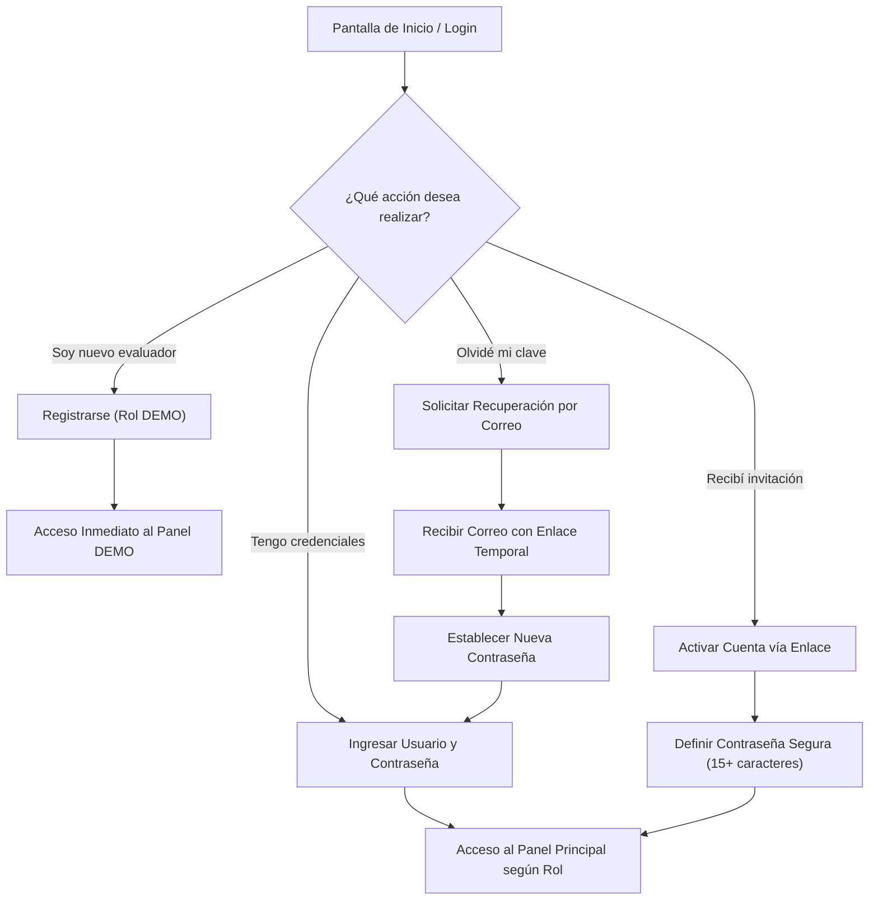
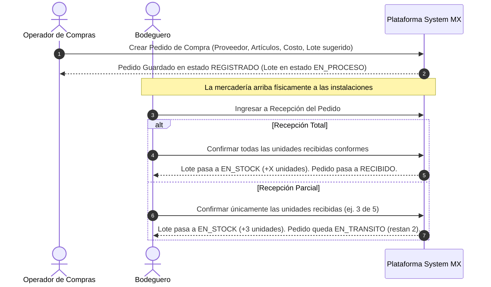
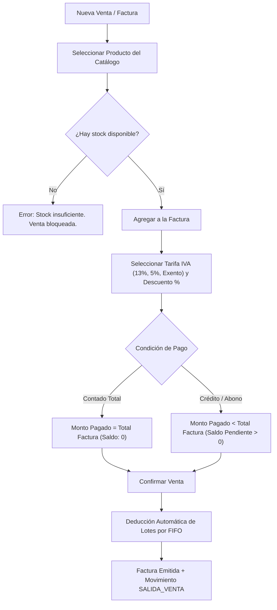

# 04 — MANUAL DE USUARIO — SYSTEM MX

**Proyecto:** System MX — Plataforma Web de Gestión Comercial  
**Versión:** 1.0.0 (Estabilización Final)  
**Fecha:** Noviembre de 2026  
**Audiencia:** Administradores, Operadores de Compras, Vendedores, Auditores y Usuarios Finales  

---

## 1. INTRODUCCIÓN Y PRIMEROS PASOS

**System MX** es una plataforma moderna e intuitiva diseñada para simplificar la gestión comercial diaria de su empresa. La aplicación es accesible a través de cualquier navegador web moderno (Google Chrome, Mozilla Firefox, Microsoft Edge, Safari) desde computadoras de escritorio, portátiles, tabletas o teléfonos móviles.

### 1.1 Dirección de Acceso a la Plataforma
- **URL Oficial en Producción:** `https://systemmx-web-200684331.onrender.com`
- **Ambiente de Desarrollo Local:** `http://localhost:5173`

---

## 2. AUTENTICACIÓN Y GESTIÓN DE CUENTAS

### 2.1 Inicio de Sesión
1. Ingrese a la plataforma. Será recibido por la pantalla de bienvenida con la identidad visual corporativa.
2. Digite su **Nombre de Usuario** y su **Contraseña**.
3. Haga clic en el botón **"Iniciar Sesión"** o presione la tecla `Enter`.
4. El sistema validará sus credenciales de forma segura y lo redirigirá automáticamente a los módulos correspondientes a su rol asignado.

### 2.2 Registro Público de Nuevos Usuarios
Si usted es un evaluador externo o nuevo miembro del equipo:
1. En la pantalla de login, haga clic en **"¿No tienes una cuenta? Regístrate aquí"**.
2. Complete el formulario con su **Nombre Completo**, **Nombre de Usuario**, **Correo Electrónico** y **Contraseña**.
   > [!NOTE]
   > La contraseña debe cumplir con la política de seguridad estricta: mínimo 15 caracteres, incluyendo mayúsculas, minúsculas, números y símbolos especiales. La barra medidora de seguridad le indicará en tiempo real la fortaleza de su clave.
3. Al registrarse, su cuenta quedará activa de inmediato bajo el perfil **DEMO**, lo que le permitirá explorar la interfaz de manera segura sin alterar datos reales de la empresa.

### 2.3 Activación de Cuenta por Invitación
Cuando un Administrador lo invite a formar parte del equipo:
1. Recibirá un correo electrónico corporativo con un enlace único y seguro de activación.
2. Al hacer clic en el enlace, accederá a la pantalla **"Activar Cuenta"**.
3. Ingrese su nueva contraseña cumpliendo con los estándares de seguridad y confírmela.
4. Presione **"Activar Cuenta e Iniciar Sesión"** para comenzar a operar con su rol autorizado (`COMPRAS`, `VENTAS`, etc.).

### 2.4 Recuperación de Contraseña Olvidada
1. En la pantalla de inicio de sesión, presione **"¿Olvidaste tu contraseña?"**.
2. Ingrese su dirección de correo electrónico registrada y haga clic en **"Enviar enlace de recuperación"**.
3. Por motivos de seguridad y privacidad, el sistema mostrará un mensaje genérico confirmando el envío sin revelar si el correo existe o no en la base de datos.
4. Revise su bandeja de entrada, abra el enlace temporal recibido y defina su nueva contraseña.

---

## 3. ACCESIBILIDAD UNIVERSAL E INTERNACIONALIZACIÓN

System MX fue construido bajo los más altos estándares de inclusión digital (**WCAG 2.2 AAA**):

### 3.1 Selector de Idioma Dinámico
En la barra superior o pie de página encontrará el selector de idioma:
- **Español (ES)**: Idioma nativo del sistema.
- **English (EN)**: Localización completa al idioma inglés.
- **Português (PT)**: Localización completa al idioma portugués.

Al seleccionar un idioma, todos los menús, etiquetas, formularios, reportes, mensajes de error y formatos numéricos y de fecha se adaptan instantáneamente sin necesidad de recargar la página.

### 3.2 Widget de Accesibilidad UserWay
En la esquina inferior de la pantalla encontrará el icono oficial de accesibilidad de **UserWay**. Al hacer clic sobre él, podrá activar:
- **Lector de Pantalla Integrado**: Lectura de textos y elementos en voz alta.
- **Contraste Mejorado**: Modos claro, oscuro y alto contraste inverso.
- **Tamaño de Texto**: Aumento progresivo de la tipografía para personas con dificultades visuales.
- **Espaciado de Texto y Altura de Línea**: Facilita la lectura a usuarios con dislexia.
- **Guía de Lectura**: Resalta la línea actual sobre la que se encuentra el cursor.

### 3.3 Navegación Completa por Teclado
Toda la interfaz puede operarse sin utilizar el ratón:
- `Tab`: Avanzar al siguiente campo interactivo o botón.
- `Shift + Tab`: Retroceder al elemento interactivo anterior.
- `Enter` / `Espacio`: Seleccionar opciones, abrir modales o confirmar formularios.
- `Escape`: Cerrar cualquier ventana modal o diálogo de confirmación abierto.

---

## 4. ADMINISTRACIÓN DE USUARIOS Y ROLES (SOLO ADMIN)

El módulo de Usuarios (`/usuarios`) permite al Administrador controlar el acceso y los privilegios de todo el personal:

1. **Invitar a un Nuevo Colaborador:**
   - Presione el botón **"+ Invitar Usuario"**.
   - Digite el nombre de usuario, nombre completo y correo electrónico.
   - Seleccione el rol deseado: `ADMIN`, `COMPRAS`, `VENTAS` o `CONSULTA`.
   - Haga clic en **"Enviar Invitación"**. El sistema despachará automáticamente el correo con el enlace criptográfico de activación.

2. **Reenviar Invitación:**
   - En la tabla de usuarios, si un colaborador tiene estado *"Pendiente de Activación"*, el Administrador puede hacer clic en el botón de reenvío para generar un nuevo enlace vigente.

3. **Cambiar Rol o Estado de un Usuario:**
   - El Administrador puede suspender temporalmente a un usuario o cambiar su rol.
   > [!IMPORTANT]
   > Al cambiar el rol o estado de un usuario, todas sus sesiones activas se cierran inmediatamente en tiempo real por seguridad (mecanismo de versionado de credenciales).

---

## 5. MANTENIMIENTO DE CATÁLOGOS BASE

### 5.1 Categorías de Productos
Permite organizar el catálogo por familias (e.g., *Cascos*, *Repuestos de Motor*, *Llantas y Neumáticos*, *Lubricantes*):
- Ingrese al módulo **Categorías**.
- Haga clic en **"+ Nueva Categoría"**, digite el nombre y descripción, y guarde los cambios.

### 5.2 Directorio de Proveedores
Permite registrar fabricantes y distribuidores tanto nacionales como extranjeros:
- Ingrese al módulo **Proveedores**.
- Presione **"+ Registrar Proveedor"**.
- Ingrese la razón social, país de origen, teléfono, correo electrónico y moneda preferida (`CRC`, `USD`, `EUR`, etc.).

### 5.3 Tarifas de IVA (Configuración Fiscal)
- Exclusivo para el rol `ADMIN`.
- Permite configurar los porcentajes impositivos aplicables en el país (e.g., `IVA General 13%`, `Tarifa Reducida 5%`, `Exento 0%`).

---

## 6. CICLO DE COMPRAS Y RECEPCIÓN EN ALMACÉN

### 6.1 Registro de Pedido de Compra
1. Diríjase a **Pedidos de Compra** y presione **"+ Nuevo Pedido"**.
2. Seleccione el **Proveedor**, la **Fecha de la Orden**, la **Moneda de Compra** y el **Tipo de Cambio**.
3. En la sección de detalle, agregue los artículos que conformarán el pedido:
   - Digite el nombre del producto (si es un producto nuevo, nacerá automáticamente en el catálogo).
   - Seleccione la **Categoría**.
   - Indique el código de lote inicial (e.g., `L1`).
   - Especifique la **Cantidad Solicitada**, el **Costo Unitario** en moneda de origen y el **Precio de Venta Sugerido**.
4. Guarde el pedido. El pedido quedará en estado `REGISTRADO` y el lote se inicializará en `EN_PROCESO` con **stock 0** (no estará disponible para la venta hasta que la mercadería sea recibida físicamente).

### 6.2 Recepción Física en Almacén
1. Cuando la mercadería llegue al almacén, busque el pedido en la lista y presione **"Recepción"**.
2. Indique la fecha de recepción física.
3. Para cada lote del pedido, verifique las unidades recibidas y digite la cantidad física real:
   - **Recepción Completa:** Si recibe todas las unidades, el pedido cambiará automáticamente a estado `RECIBIDO` y las unidades ingresarán de inmediato al stock disponible para la venta.
   - **Recepción Parcial:** Si solo llega una parte del embarque, digite la cantidad efectivamente recibida. El lote activará las unidades recibidas en stock, y el pedido permanecerá en estado `EN_TRANSITO` a la espera de las unidades restantes.
4. El sistema generará automáticamente un registro inmutable en el kardex (`ENTRADA_COMPRA`) con la hora y el usuario responsable de la recepción.

---

## 7. CONTROL DE INVENTARIO Y LOTES (METODOLOGÍA FIFO)

El módulo de Inventario (`/inventario`) le permite conocer con total precisión las existencias de su negocio:

1. **Stock Consolidado por Producto:**
   - Muestra las unidades totales disponibles para la venta de cada artículo en tiempo real.
2. **Desglose Granular por Lote:**
   - Permite auditar cada lote físico individual: código de lote (`L1`, `L2`), fecha de entrada, costo unitario real de compra y estado actual (`EN_STOCK`, `VENDIDO_PARCIAL`, `AGOTADO`).
3. **Kardex de Movimientos:**
   - Libro mayor inmutable que registra cada entrada por compra, salida por venta y reingreso por anulación, indicando el usuario responsable, las unidades afectadas y la valuación económica.

---

## 8. PUNTO DE VENTA Y FACTURACIÓN COMERCIAL

El módulo de Ventas (`/ventas`) está diseñado para agilizar la atención al cliente con máxima seguridad operativa:

### 8.1 Emisión de una Venta
1. Presione **"+ Nueva Venta"**.
2. Digite el nombre del **Cliente** y la **Fecha de la Venta**.
3. En la línea de productos:
   - Seleccione el producto disponible en almacén.
   - Indique la **Cantidad a vender** (el sistema no permitirá digitar cantidades superiores a las existencias físicas).
   - Seleccione la **Tarifa de IVA** aplicable y aplique un porcentaje de descuento si corresponde.
4. En las condiciones de pago:
   - Seleccione el **Medio de Pago** (*Efectivo*, *Transferencia*, *SINPE Móvil*, *Tarjeta*, *Mixto*).
   - Ingrese el **Monto Pagado**:
     - Si el cliente paga la totalidad, el saldo pendiente será `0` y la venta quedará liquidada.
     - Si el cliente deja un saldo pendiente, la factura se registrará como venta a crédito y pasará automáticamente al módulo de Cuentas por Cobrar.
5. Al hacer clic en **"Emitir Venta"**:
   - El sistema aplica automáticamente el algoritmo **FIFO (First In, First Out)**: deduce primero las unidades de los lotes más antiguos que ingresaron a bodega.
   - Se calcula la ganancia bruta real de la venta comparando el precio cobrado contra el costo histórico de adquisición del lote específico despachado.

---

## 9. CUENTAS POR COBRAR Y CONCILIACIÓN DE PAGOS

Para ventas con saldo pendiente:
1. Ingrese a **Cuentas por Cobrar** (`/reportes/cuentas-por-cobrar`).
2. Localice al cliente y el número de factura. Podrá visualizar el importe original, los abonos acumulados y el saldo pendiente exacto.
3. Para registrar un nuevo pago:
   - Presione **"Registrar Abono"**.
   - Ingrese el monto del abono, el método de pago y la referencia bancaria.
   - El sistema descontará el saldo pendiente de inmediato y creará una entrada inmutable en el historial de pagos (`pago_venta`).
4. Cuando el saldo pendiente llegue a `0`, la factura cambiará a estado **CONCILIADA** con diferencia cero en el informe de conciliación financiera.

---

## 10. ANULACIÓN DE VENTAS Y DEVOLUCIONES

En caso de un error de facturación o una devolución autorizada:
1. Ubique la venta en el listado y presione el botón **"Anular Venta"**.
2. Confirme la operación en el diálogo de seguridad.
3. El sistema ejecutará automáticamente las siguientes acciones:
   - La venta pasará a estado `ANULADA` y saldrá de las ventas comerciales válidas en los reportes de ingresos.
   - Las unidades vendidas se reintegrarán automáticamente a sus lotes originales de procedencia.
   - Se creará un movimiento en el kardex de tipo `REINGRESO_ANULACION_VENTA`.
   - Los registros de pago previos se conservarán intactos para mantener la integridad de la auditoría de caja.

---

## 11. CENTRO DE REPORTES Y ANÁLISIS DE NEGOCIO

El centro de reportería analítica ofrece **28 reportes ejecutivos** organizados en 7 familias:

1. **Familia Resumen (Dashboard Ejecutivo):** Visión general de ventas, compras, valor del inventario y utilidades brutas.
2. **Familia Ventas:** Ventas por período, ventas por producto, ventas por cliente y ranking de artículos más vendidos.
3. **Familia Inventario:** Valorización de inventario, stock por lote, alertas de stock mínimo y **Reconstrucción de Inventario Histórico** a cualquier fecha de corte pasada.
4. **Familia Compras:** Compras por proveedor, órdenes por estado y costos de importación.
5. **Familia Pagos:** Recaudación diaria, abonos por método de pago y conciliación financiera.
6. **Familia Cuentas:** Cartera de cuentas por cobrar, vencimientos de crédito y saldos de clientes.
7. **Familia Auditoría (Exclusivo ADMIN):** Bitácora de actividades por usuario y análisis de transacciones legacy vs modernas.

> [!TIP]
> Todos los reportes cuentan con exportación a formato **CSV** e impresión formateada lista para generar documentos **PDF**.
